# Milestone 1 — Initial Access (`medirozahospital.com`)

## 1. Scope, Authorization & Rules of Engagement
- **Target:** `https://medirozahospital.com`
- **Reference:** `WK4 Mediroza v1.pdf` (Authorized lab engagement; testing restricted strictly to `medirozahospital.com` with single requests, no automated scanners/brute-forcing loops, and no denial-of-service traffic).
- **Milestone 1 Objective:** Perform reconnaissance using Kali Linux tools, analyze authentication and input-handling behavior, gain unauthorized access to the patient portal, and retrieve the 3 confidential patient PDF lab reports for Milestone 2.
- **Screenshot Evidence:** 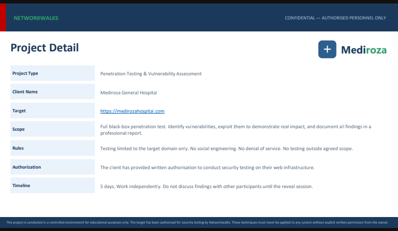

## 2. Reconnaissance & Footprinting (Relevant Tools Only)
Focused reconnaissance on the tools that returned actionable findings for `medirozahospital.com` (omitting tools that yielded no extra signal):

1. **`whois` (Domain Registration & Ownership):**
   - *Findings:* Registered via NameCheap, Inc. (IANA `1068`, ID `3132326963_DOMAIN_COM-VRSN`); created `2026-08-14`, updated `2026-08-14`, expires `2027-08-14`; name servers `DNS1.NAMECHEAPHOSTING.COM` and `DNS2.NAMECHEAPHOSTING.COM`; status `clientTransferProhibited`.
   - *Screenshot evidence:* 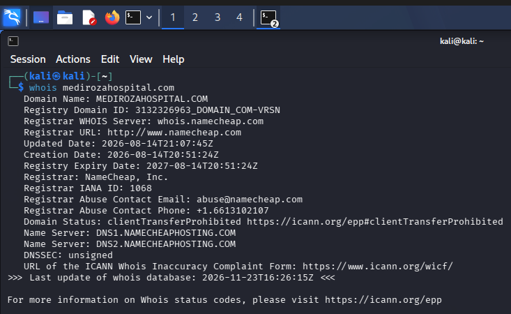
2. **`whatweb` (Server & Redirect Behavior):**
   - *Findings:* Resolved to `199.188.201.16` (`US`), `LiteSpeed` (`HTTPServer[LiteSpeed]`, `PoweredBy[LiteSpeed]`, `x-turbo-charged-by`, `HTML5`); `http://medirozahospital.com` returned `301` to `https://medirozahospital.com/`, which returned `403 Forbidden` to `whatweb`.
   - *Screenshot evidence:*    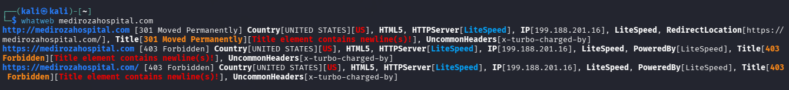
3. **`curl` (HTTP Headers, Sessions & Endpoints):**
   - *Findings:* Confirmed `PHP/8.2.36` over `LiteSpeed` (`Mediroza CMS 1.4.2`), inspected `PHPSESSID` and `Cache-Control` headers, mapped `/patient/login.php` and `/patient/portal.php` (`.report-row`), and verified unauthenticated portal redirects back to `/patient/login.php`.
   - *Screenshot evidence:*  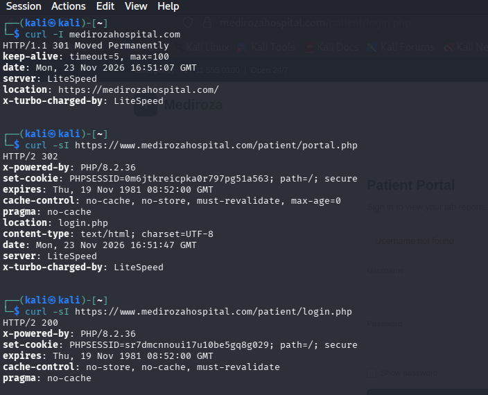

### Exposed Entry Points & Session Behavior Identified
- **Authentication Form:** `/patient/login.php` (`POST` accepting `username` and `password`).
- **Protected Portal:** `/patient/portal.php` (displays `.report-row` lab report entries when authenticated; redirects unauthenticated `GET` requests and unauthenticated `PHPSESSID` states back to `/patient/login.php`).
- **Screenshot evidence:**  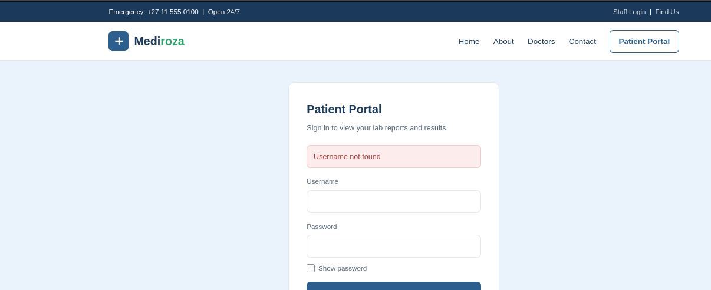.
## 3. Pre-Access Analysis & Response Baselines
Before achieving portal access, single-request observations on `/patient/login.php` established distinct response baselines:
- **Standard Failure Responses (`2281` bytes, `HTTP/2 200 OK`):**
  - Unfound user test cases returned `
Username not found
`.
  - Existing user test cases returned `
Incorrect password
`, indicating separate user lookup and credential verification paths.
  - *Screenshot evidence:* 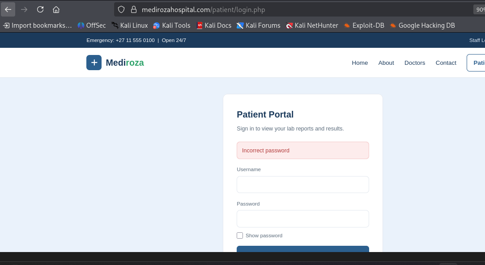.
  - 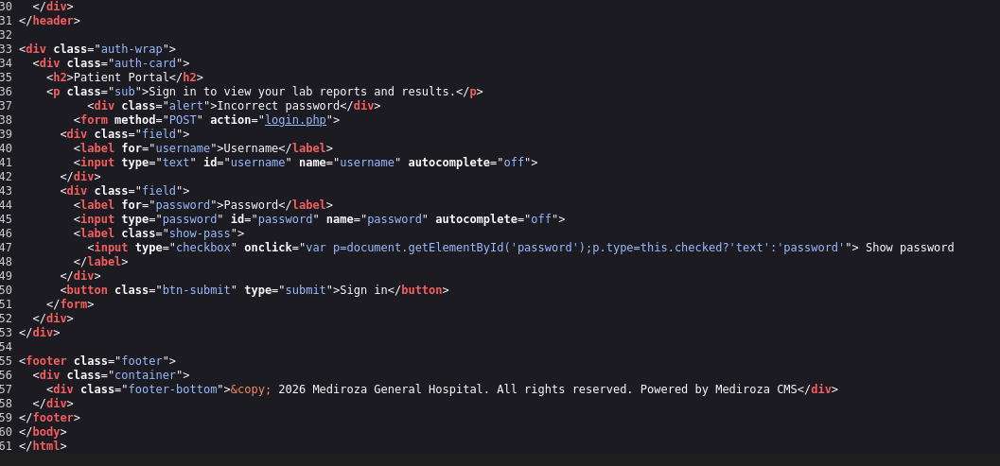

- **Verbose SQL Error Responses (`2451`–`2471` bytes, `HTTP/2 200 OK`):**
  - Certain single-quote (`'`) inputs triggered `Warning: mysqli_query(): You have an error in your SQL syntax...` (such as `near '' OR '1'='1'' at line 1` at `2471` bytes), revealing single-quote string framing around `username` and unparameterized query construction.
  - *Screenshot evidence:* 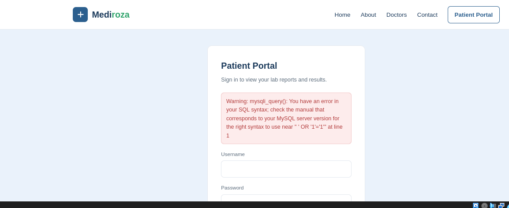.
- **Non-Error / Non-Matching Variants:** Inputs that executed without a syntax error returned `2281`-byte alerts until a valid session transition occurred.
  - *Screenshot evidence:* 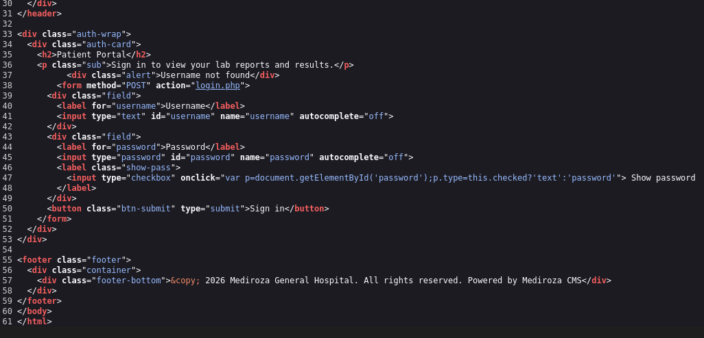.

## 4. Access Achievement & Milestone 2 Handoff
- **Access Proof:** Obtained an authenticated session (`PHPSESSID`) and accessed `/patient/portal.php` (`200 OK`) showing `.report-row` entries.
  - *Screenshot evidence:* 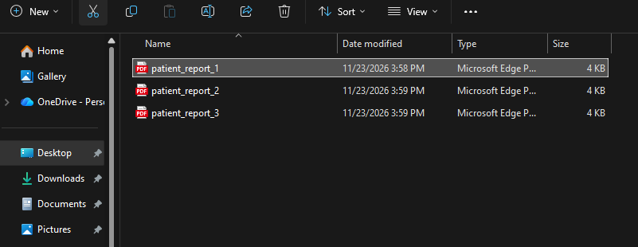.
   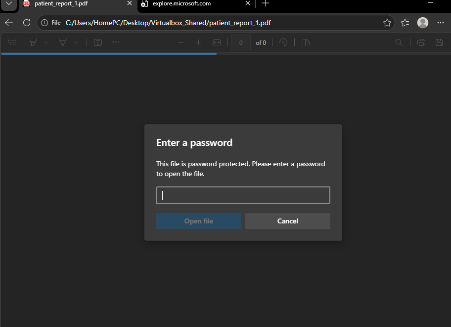.
- **Milestone 2 Handoff:** Retrieved the target report files locally outside the repository for separate **Milestone 2** encryption/hash analysis (individual file details, SHA keys, and file screenshots are tracked under M2).

## 5. Remediation Recommendations
- **Prepared Statements:** Refactor `/patient/login.php` database queries to use parameterized prepared statements (`mysqli_prepare` with bound parameters) instead of string concatenation.
- **Error Handling & Generic Auth Responses:** Disable verbose `mysqli` / PHP error display in production and return uniform, non-enumerating authentication messages.
- **Session Enforcement:** Verify authenticated session state at the top of `/patient/portal.php` and all report-retrieval endpoints before serving records.
- *Screenshot evidence:* 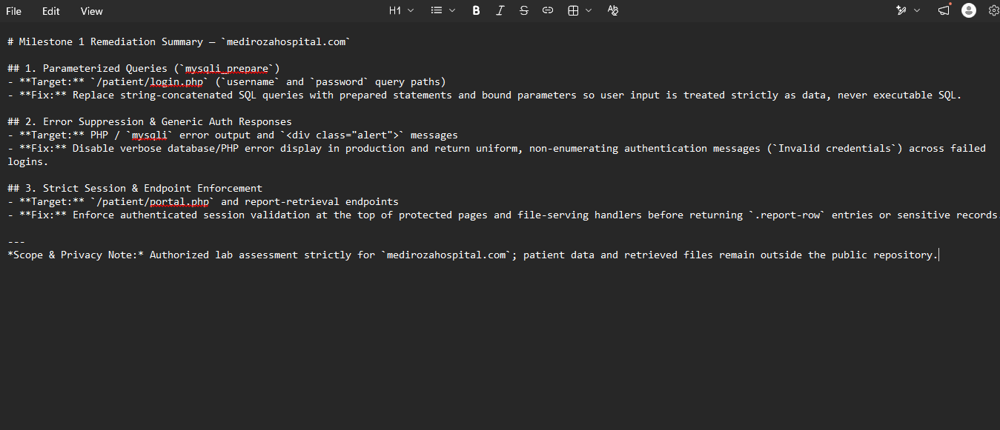.
