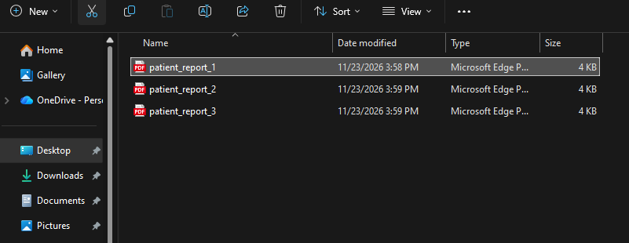
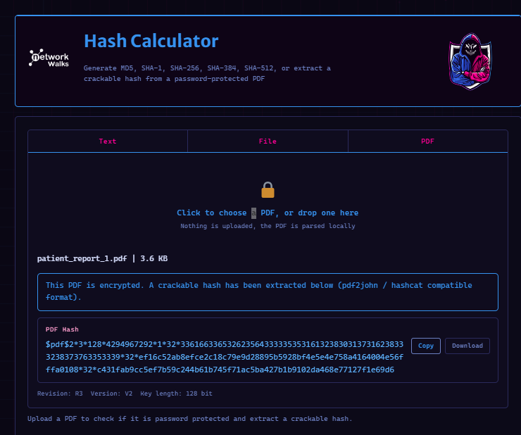
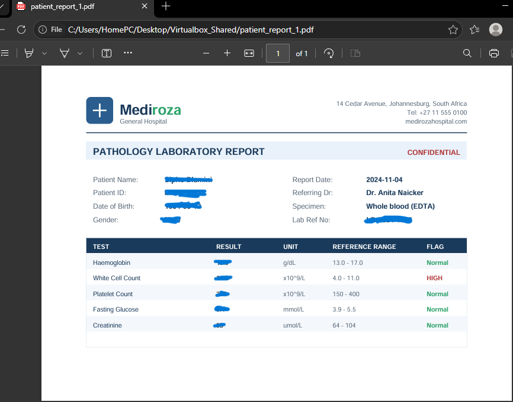
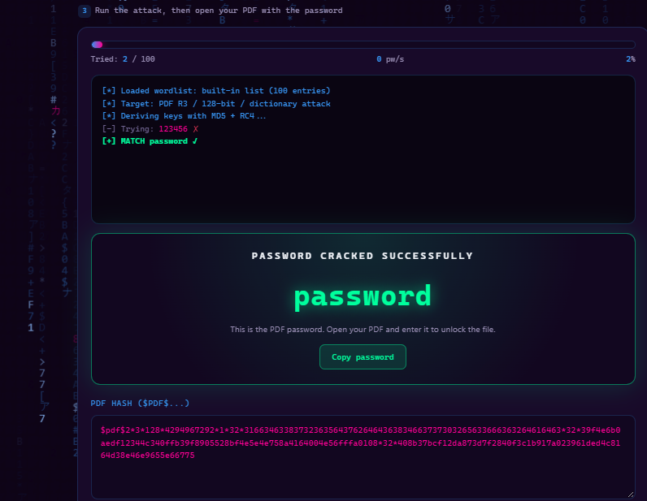
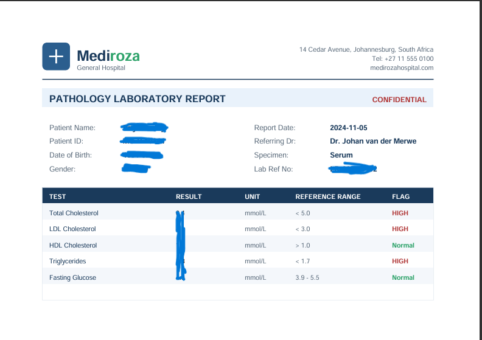
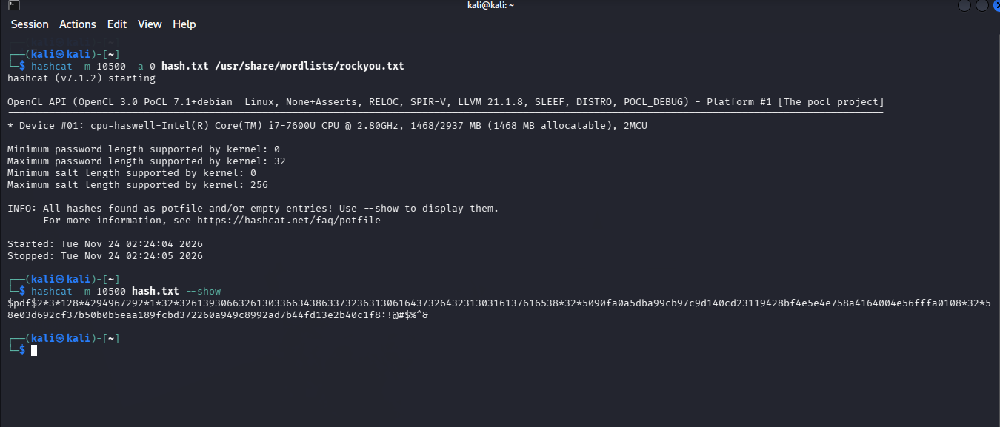
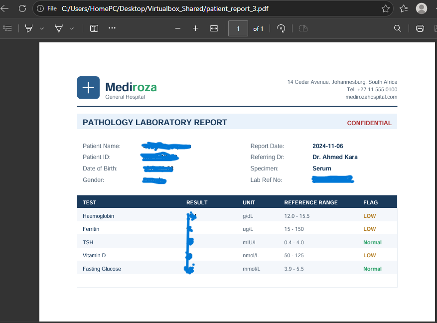

# Milestone 2 — Data Extraction (`medirozahospital.com`)

## 1. Scope, Authorization & File Handling Hygiene
- **Target Context:** 3 confidential patient PDF lab reports retrieved during Milestone 1 (`https://medirozahospital.com`, per `WK4 Mediroza v1.pdf`).
- **Authorization & Rules:** Conducted strictly within authorized lab scope on local files only; no external or unauthorized target activity.
- **Tooling Used:** Online hash calculator and Networkwalks hash calculator for hash extraction; Networkwalks Password Crack for initial password recovery on PDF 1 and PDF 2, followed by `hashcat` with `rockyou.txt` on Kali Linux for PDF 3 after the built-in 100-password list did not match.
- **Repository Hygiene:** Raw PDF files, unredacted patient PII, and sensitive details remain local outside the repository; only sanitized methodology, metadata, and proof screenshots are documented here.
- **Screenshot Evidence:** 

## 2. File 1 — Encryption Analysis & Recovery
- **File Reference:** Patient Report 1 (stored locally; excluded from repository)
- **Hash Extraction (`Online Hash Calculator` / `Networkwalks Hash Calculator`):** Extracted the hash value using the online hash calculator and Networkwalks hash calculator.
- **Password Recovery (`Networkwalks Password Crack`):** Submitted the extracted hash value to Networkwalks Password Crack and recovered the password (`123456`) within the built-in wordlist.
- **Recovery Outcome:** **Cracked** — confirmed local access to  Patient Report 1.
- **Screenshot Evidence:**  and 

## 3. File 2 — Encryption Analysis & Recovery
- **File Reference:** Patient Report 2 (stored locally; excluded from repository)
- **Hash Extraction (`Online Hash Calculator` / `Networkwalks Hash Calculator`):** Extracted the hash value using the online hash calculator and Networkwalks hash calculator.
- **Password Recovery (`Networkwalks Password Crack`):** Submitted the extracted hash value to Networkwalks Password Crack and recovered the password (`password`) within the built-in wordlist.
- **Recovery Outcome:** **Cracked** — confirmed local access to Patient Report 2.
- **Screenshot Evidence:**  and 

## 4. File 3 — Encryption Analysis & Recovery
- **File Reference:** Patient Report 3 (stored locally; excluded from repository)
- **Hash Extraction (`Online Hash Calculator` / `Networkwalks Hash Calculator`):** Extracted the hash value using the online hash calculator and Networkwalks hash calculator.
- **Initial Attempt & Adaptation (`Networkwalks Password Crack` → Kali `hashcat` + `rockyou.txt`):** Initial submission to Networkwalks Password Crack returned *"Access denied / Not cracked with this wordlist"* because the candidate (`!@#$%^&`) was outside the built-in 100-password list. Adapted by running `hashcat` on Kali Linux against the extracted hash using the larger `rockyou.txt` wordlist to recover the password (`!@#$%^&`).
- **Recovery Outcome:** **Cracked (via Kali `hashcat` + `rockyou.txt`)** — recovered the password after expanding beyond the 100-password list, confirming local access to Patient Report 3.
- **Screenshot Evidence:**  and 
## 5. Cross-File Observations & Handoff to Milestone 3
- **Password Complexity & Cracking Behavior Across Files 1–3:**
  - **PDF 1 (`123456`) & PDF 2 (`password`):** Both relied on trivial, high-frequency passwords present within Networkwalks Password Crack's built-in 100-password list, allowing direct recovery without expanding wordlists.
  - **PDF 3 (`!@#$%^&`):** Used a non-alphanumeric symbol sequence outside the built-in 100-password list, causing Networkwalks Password Crack to return an *"Access denied / Not cracked with this wordlist"* result and requiring a pivot to `hashcat` with `rockyou.txt` on Kali Linux.
- **Hash Extraction & Tooling Consistency vs. Adaptation:**
  - Across all three PDFs, hash extraction relied on the online hash calculator and Networkwalks hash calculator before password recovery, while cracking required tool adaptation when the initial small wordlist reached its limit on PDF 3.
  - This reinforces the Milestone 2 approach of evaluating each file separately rather than assuming identical password complexity or single-tool recovery across all retrieved files.
- **Data Exposure & Operational Risk Observations:**
  - Weak or predictable credentials on sensitive lab report PDFs (`123456`, `password`, and a symbol-only string) mean access controls on individual files can be bypassed once hash values are obtained, increasing exposure risk for confidential records if files are not protected with strong, unique secrets and proper access controls.
  - Keeping raw PDFs, recovered plaintext passwords, and unredacted patient PII strictly local outside the GitHub repository prevents accidental public exposure of sensitive health and credential data.
