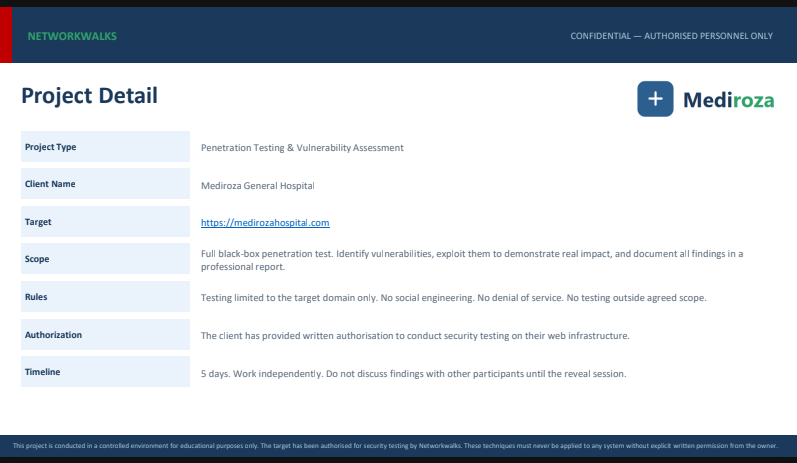
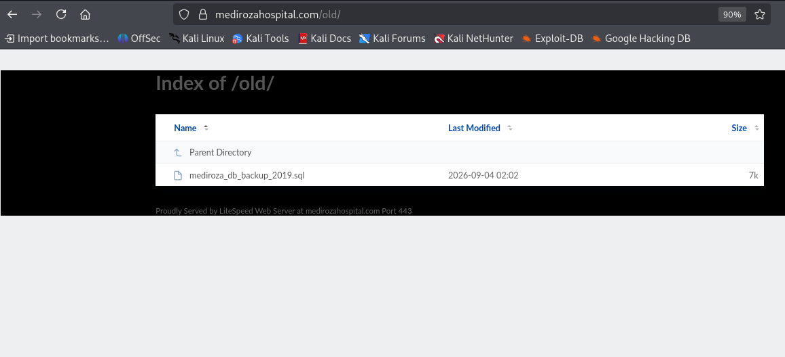
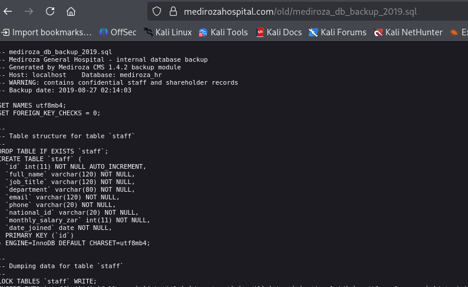
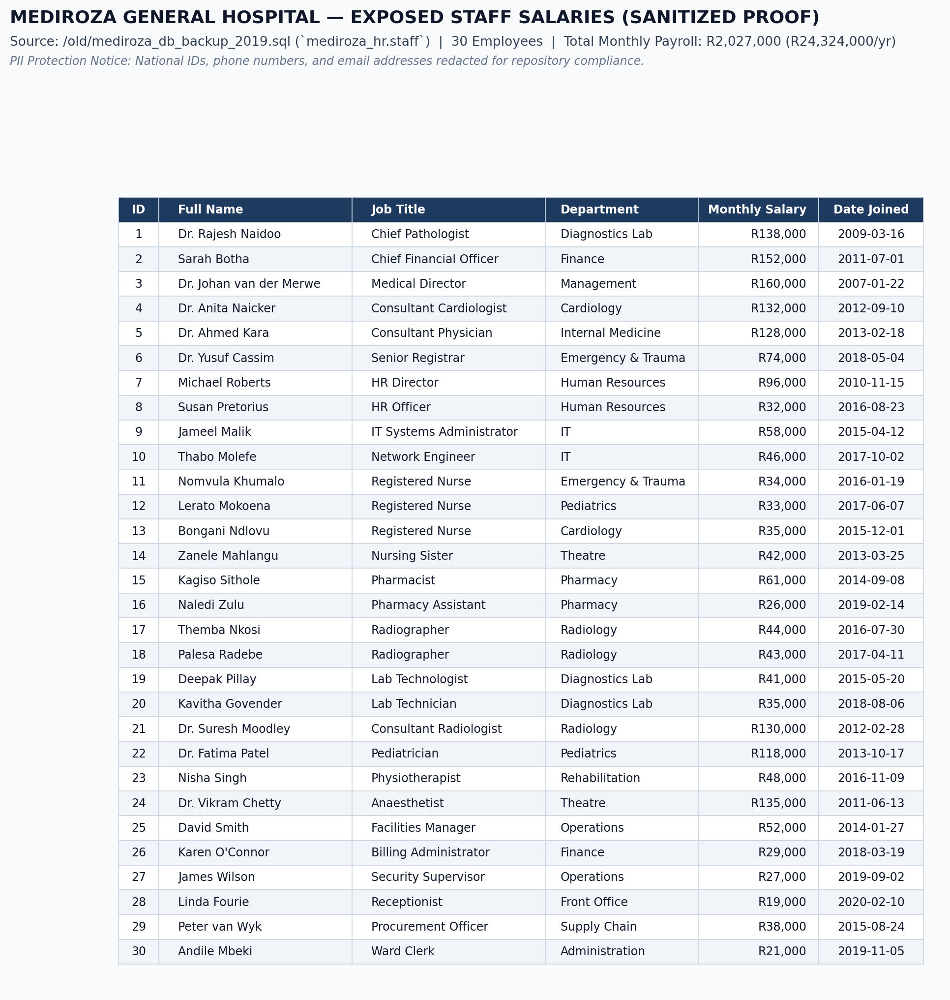
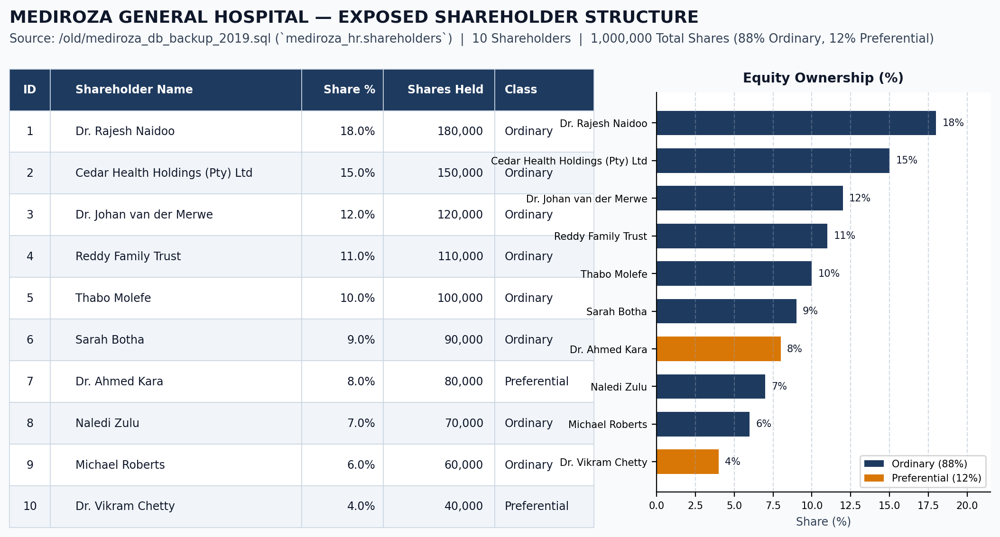
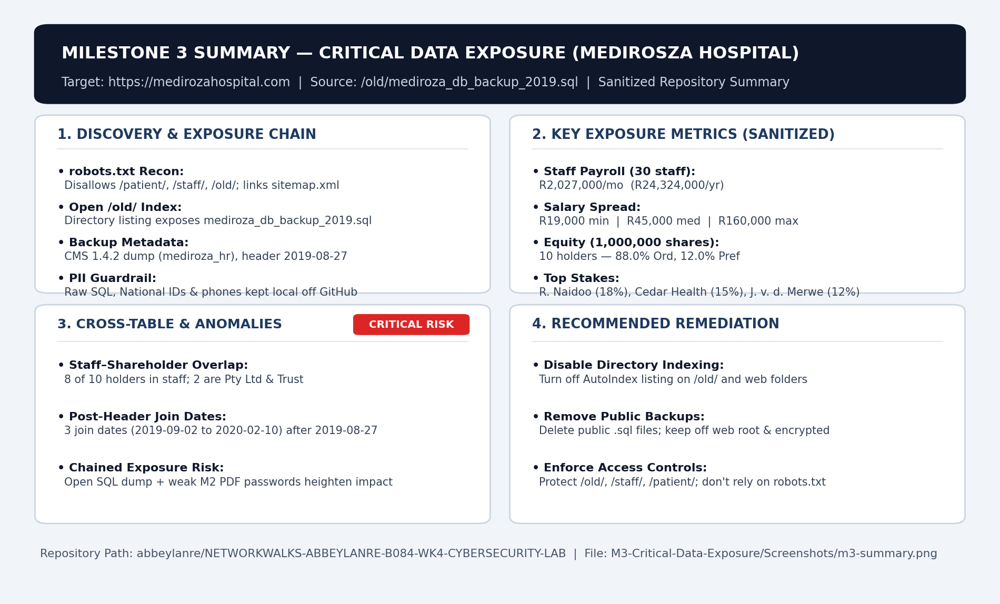

# Milestone 3 — Attack & Critical Data Exposure (`medirozahospital.com`)

## 1. Executive Overview, Scope & Repository Hygiene
- **Target & Assessment Scope:** Authorized black-box penetration testing engagement on `https://medirozahospital.com` (Mediroza General Hospital) conducted on Kali Linux per `WK4 Mediroza v1.pdf` (Milestone 3: *Find the critical data exposure on the client server*).
- **Rules of Engagement:** Testing was restricted strictly to the authorized target domain and controlled lab environment, with no denial-of-service, social engineering, or out-of-scope testing.
- **Deliverable & Repository Hygiene:** This document provides the sanitized discovery path, proof-of-exposure structure, employee salary summary, shareholder breakdown, cross-table observations, risk analysis, and remediation steps. Raw SQL dump files (`mediroza_db_backup_2019.sql`), national IDs, phone numbers, and unredacted personal identifiers remain strictly local outside this GitHub repository.
- **Screenshot Evidence:**  

## 2. Reconnaissance & Discovery Chain (`robots.txt` → `/old/` → SQL Backup)
- **Step 1 — Inspecting robots.txt:** Requesting `https://medirozahospital.com/robots.txt` revealed explicit `Disallow` directives for `/patient/`, `/staff/`, and `/old/`, along with a pointer to `https://medirozahospital.com/sitemap.xml`.
- **Step 2 — Enumerating /old/:** Accessing `https://medirozahospital.com/old/` returned an open directory index (`Index of /old/`) rather than an access-denied or non-indexed response, exposing `mediroza_db_backup_2019.sql`.
- **Step 3 — Backup Metadata & Provenance Inspection:** Examining the header of `mediroza_db_backup_2019.sql` identified it as an internal database dump (`Database: mediroza_hr`) generated by **Mediroza CMS 1.4.2**, containing a header timestamp of `2019-08-27 02:14:03` (and directory listing entry `2026-09-04 02:02`) with a warning indicating confidential staff and shareholder records.
- **Screenshot Evidence:**  and 

## 3. Hospital Employee Salaries (`staff` Table — 30 Employees)
The `staff` table in `mediroza_db_backup_2019.sql` contains **30 employee records** across 17 departments (`id`, `full_name`, `job_title`, `department`, `email`, `phone`, `national_id`, `monthly_salary_zar`, and `date_joined`).

### 3.1 Compensation Statistics
- **Total Monthly Payroll:** **R2,027,000** (**R24,324,000** annualized).
- **Distribution Metrics:** Mean **R67,567/month** | Median **R45,000/month** | Minimum **R19,000/month** | Maximum **R160,000/month**.
- **Top Earners:** Dr. Johan van der Merwe (Medical Director, **R160,000**), Sarah Botha (Chief Financial Officer, **R152,000**), Dr. Rajesh Naidoo (Chief Pathologist, **R138,000**), Dr. Vikram Chetty (Anaesthetist, **R135,000**), and Dr. Anita Naicker (Consultant Cardiologist, **R132,000**).
- **Lowest Earners:** Linda Fourie (Receptionist, **R19,000**), Andile Mbeki (Ward Clerk, **R21,000**), Naledi Zulu (Pharmacy Assistant, **R26,000**), James Wilson (Security Supervisor, **R27,000**), and Karen O'Connor (Billing Administrator, **R29,000**).

### 3.2 Department Payroll Rollup
| Department | Headcount | Monthly Payroll (ZAR) | Average Monthly Salary (ZAR) |
| :--- | :---: | ---: | ---: |
| Radiology | 3 | R217,000 | R72,333 |
| Diagnostics Lab | 3 | R214,000 | R71,333 |
| Finance | 2 | R181,000 | R90,500 |
| Theatre | 2 | R177,000 | R88,500 |
| Cardiology | 2 | R167,000 | R83,500 |
| Management | 1 | R160,000 | R160,000 |
| Pediatrics | 2 | R151,000 | R75,500 |
| Internal Medicine | 1 | R128,000 | R128,000 |
| Human Resources | 2 | R128,000 | R64,000 |
| Emergency & Trauma | 2 | R108,000 | R54,000 |
| IT | 2 | R104,000 | R52,000 |
| Pharmacy | 2 | R87,000 | R43,500 |
| Operations | 2 | R79,000 | R39,500 |
| Rehabilitation | 1 | R48,000 | R48,000 |
| Supply Chain | 1 | R38,000 | R38,000 |
| Administration | 1 | R21,000 | R21,000 |
| Front Office | 1 | R19,000 | R19,000 |

### 3.3 Employee Salary & Join-Date Breakdown (Redacted IDs/Phones)
| ID | Full Name | Job Title | Department | Monthly Salary (ZAR) | Date Joined |
| :---: | :--- | :--- | :--- | ---: | :--- |
| 1 | Dr. Rajesh Naidoo | Chief Pathologist | Diagnostics Lab | R138,000 | 2009-03-16 |
| 2 | Sarah Botha | Chief Financial Officer | Finance | R152,000 | 2011-07-01 |
| 3 | Dr. Johan van der Merwe | Medical Director | Management | R160,000 | 2007-01-22 |
| 4 | Dr. Anita Naicker | Consultant Cardiologist | Cardiology | R132,000 | 2012-09-10 |
| 5 | Dr. Ahmed Kara | Consultant Physician | Internal Medicine | R128,000 | 2013-02-18 |
| 6 | Dr. Yusuf Cassim | Senior Registrar | Emergency & Trauma | R74,000 | 2018-05-04 |
| 7 | Michael Roberts | HR Director | Human Resources | R96,000 | 2010-11-15 |
| 8 | Susan Pretorius | HR Officer | Human Resources | R32,000 | 2016-08-23 |
| 9 | Jameel Malik | IT Systems Administrator | IT | R58,000 | 2015-04-12 |
| 10 | Thabo Molefe | Network Engineer | IT | R46,000 | 2017-10-02 |
| 11 | Nomvula Khumalo | Registered Nurse | Emergency & Trauma | R34,000 | 2016-01-19 |
| 12 | Lerato Mokoena | Registered Nurse | Pediatrics | R33,000 | 2017-06-07 |
| 13 | Bongani Ndlovu | Registered Nurse | Cardiology | R35,000 | 2015-12-01 |
| 14 | Zanele Mahlangu | Nursing Sister | Theatre | R42,000 | 2013-03-25 |
| 15 | Kagiso Sithole | Pharmacist | Pharmacy | R61,000 | 2014-09-08 |
| 16 | Naledi Zulu | Pharmacy Assistant | Pharmacy | R26,000 | 2019-02-14 |
| 17 | Themba Nkosi | Radiographer | Radiology | R44,000 | 2016-07-30 |
| 18 | Palesa Radebe | Radiographer | Radiology | R43,000 | 2017-04-11 |
| 19 | Deepak Pillay | Lab Technologist | Diagnostics Lab | R41,000 | 2015-05-20 |
| 20 | Kavitha Govender | Lab Technician | Diagnostics Lab | R35,000 | 2018-08-06 |
| 21 | Dr. Suresh Moodley | Consultant Radiologist | Radiology | R130,000 | 2012-02-28 |
| 22 | Dr. Fatima Patel | Pediatrician | Pediatrics | R118,000 | 2013-10-17 |
| 23 | Nisha Singh | Physiotherapist | Rehabilitation | R48,000 | 2016-11-09 |
| 24 | Dr. Vikram Chetty | Anaesthetist | Theatre | R135,000 | 2011-06-13 |
| 25 | David Smith | Facilities Manager | Operations | R52,000 | 2014-01-27 |
| 26 | Karen O'Connor | Billing Administrator | Finance | R29,000 | 2018-03-19 |
| 27 | James Wilson | Security Supervisor | Operations | R27,000 | 2019-09-02 |
| 28 | Linda Fourie | Receptionist | Front Office | R19,000 | 2020-02-10 |
| 29 | Peter van Wyk | Procurement Officer | Supply Chain | R38,000 | 2015-08-24 |
| 30 | Andile Mbeki | Ward Clerk | Administration | R21,000 | 2019-11-05 |

- **Screenshot Evidence:** .

## 4. Hospital Shareholder Details (`shareholders` Table — 1,000,000 Shares)
The `shareholders` table in `mediroza_db_backup_2019.sql` lists **10 shareholders** accounting for **1,000,000 shares** (**100.0%** total equity):
- **Ordinary Shares:** **8 shareholders** hold **880,000 shares** (**88.0%**).
- **Preferential Shares:** **2 shareholders** hold **120,000 shares** (**12.0%**).

| ID | Shareholder Name | Ownership (%) | Shares Held | Share Class |
| :---: | :--- | ---: | ---: | :--- |
| 1 | Dr. Rajesh Naidoo | 18.0% | 180,000 | Ordinary |
| 2 | Cedar Health Holdings (Pty) Ltd | 15.0% | 150,000 | Ordinary |
| 3 | Dr. Johan van der Merwe | 12.0% | 120,000 | Ordinary |
| 4 | Reddy Family Trust | 11.0% | 110,000 | Ordinary |
| 5 | Thabo Molefe | 10.0% | 100,000 | Ordinary |
| 6 | Sarah Botha | 9.0% | 90,000 | Ordinary |
| 7 | Dr. Ahmed Kara | 8.0% | 80,000 | Preferential |
| 8 | Naledi Zulu | 7.0% | 70,000 | Ordinary |
| 9 | Michael Roberts | 6.0% | 60,000 | Ordinary |
| 10 | Dr. Vikram Chetty | 4.0% | 40,000 | Preferential |

- **Screenshot Evidence:** .

## 5. Cross-Table Analysis, Risk Rating & Remediation
- **Staff & Shareholder Overlap:** **8 of the 10 shareholders** also appear as employees in the `staff` table (Dr. Rajesh Naidoo, Dr. Johan van der Merwe, Thabo Molefe, Sarah Botha, Dr. Ahmed Kara, Naledi Zulu, Michael Roberts, and Dr. Vikram Chetty), while **2** are corporate/trust entities (Cedar Health Holdings (Pty) Ltd and Reddy Family Trust).
- **Backup Timestamp vs. Join Dates:** The SQL header reports `Backup date: 2019-08-27 02:14:03`, whereas three staff entries show `date_joined` values after that date (`2019-09-02` for James Wilson, `2019-11-05` for Andile Mbeki, and `2020-02-10` for Linda Fourie), indicating post-header or appended test/sample data in the backup file.
- **Risk Assessment:** Exposing an unencrypted full database backup via an open directory listing on `/old/`—chaining with weak encryption passwords observed on sensitive files in Milestone 2—creates a **Critical** confidentiality and privacy exposure risk for employee PII, salary figures, and corporate ownership records.
- ## Remediation Recommendations:
  - **Disable directory indexing (`AutoIndex` / directory listing) across all web directories, including `/old/`.
  - **Remove `mediroza_db_backup_2019.sql` and any other backup archives from web-accessible paths; store backups outside the web root with encryption at rest and restricted access.
  - **Enforce authentication and authorization controls on sensitive directories (`/old/`, `/staff/`, `/patient/`) and review `robots.txt` so disallowed paths are protected by access controls rather than obscurity.
- **Screenshot Evidence:** .
