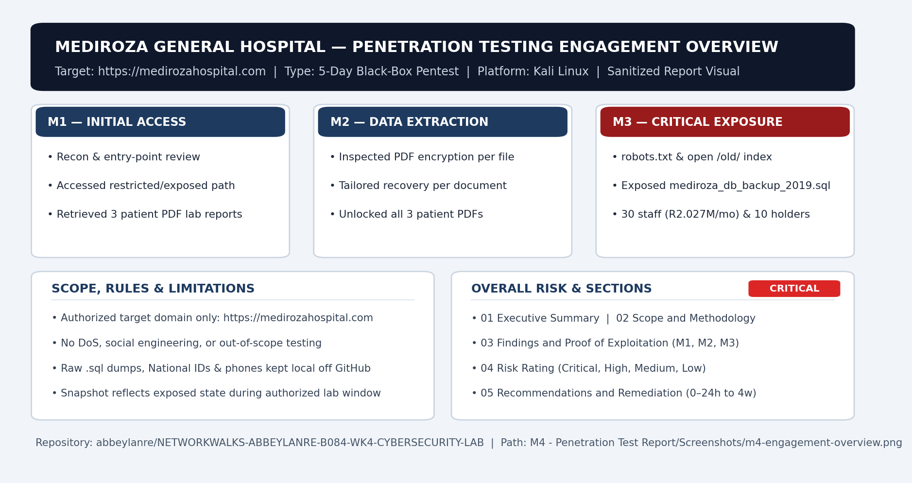
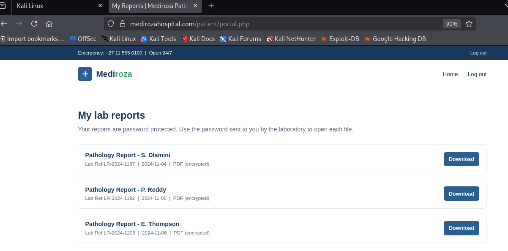
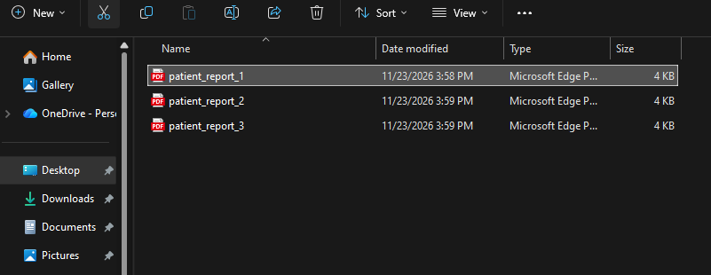
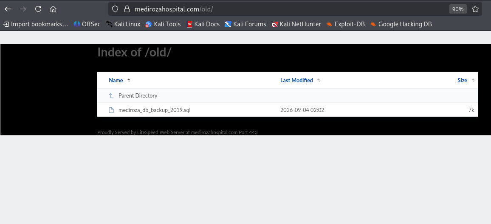
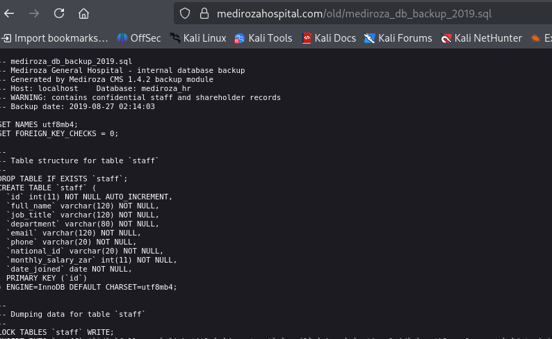
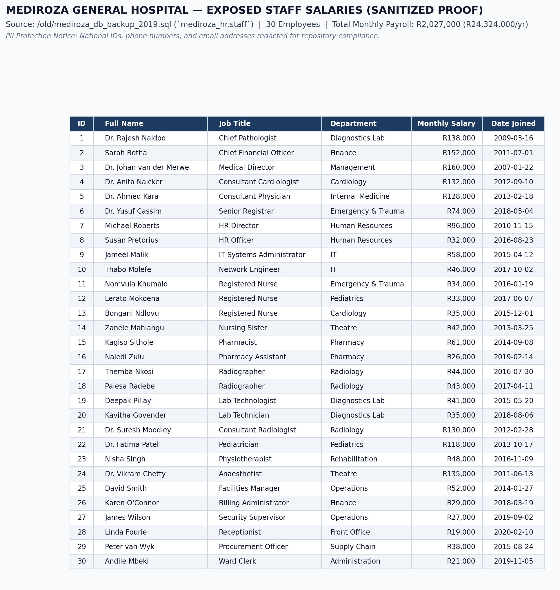
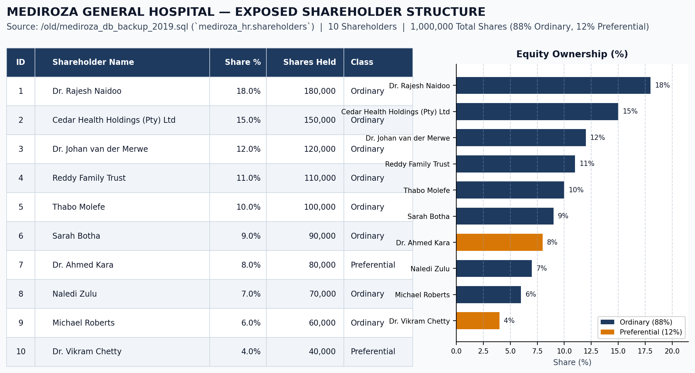
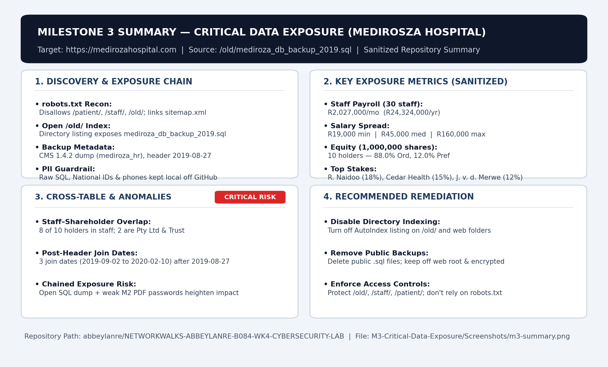
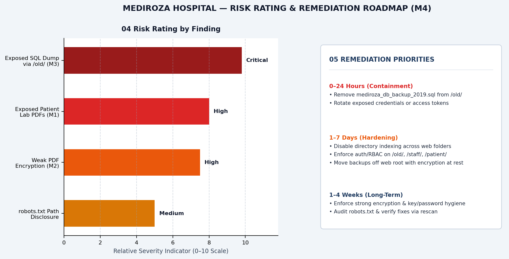

# Penetration Testing Report — Mediroza General Hospital (`medirozahospital.com`)

## 01 Executive Summary
- **Engagement Overview:** A 5-day black-box penetration testing assessment was conducted against `https://medirozahospital.com` (Mediroza General Hospital) using Kali Linux under written authorization per `WK4 Mediroza v1.pdf`.
- **Key Findings Across Milestones:**
  - **Milestone 1 (Initial Access):** Reconnaissance and entry-point analysis identified exposed web paths and allowed retrieval of **3 confidential patient PDF lab reports**.
  - **Milestone 2 (Data Extraction):** Encryption analysis and password recovery techniques successfully unlocked all **3 patient PDF lab reports**, exposing protected clinical lab records.
  - **Milestone 3 (Critical Data Exposure):** Inspecting `robots.txt` (`/patient/`, `/staff/`, `/old/`, and `sitemap.xml`) and enumerating `/old/` revealed an open directory listing (`Index of /old/`) containing `mediroza_db_backup_2019.sql` (a Mediroza CMS 1.4.2 dump for `mediroza_hr`). Analysis of the backup uncovered **30 employee records** with a combined monthly payroll of **R2,027,000** (**R24,324,000** annualized) and **10 shareholders** holding **1,000,000 shares** (**88.0%** Ordinary, **12.0%** Preferential).
- **Overall Risk & Business Impact:** The combined exposure of confidential patient lab reports, weak document encryption, and an unencrypted full database backup via an open directory index presents a **Critical** risk to patient privacy, employee and shareholder confidentiality, regulatory compliance, and organizational trust.

## 02 Scope and Methodology
- **Target & Authorization:** Assessment targeted `https://medirozahospital.com` (Mediroza General Hospital) with written authorization for controlled testing within the target domain.
- **Rules of Engagement:** Testing was restricted strictly to the authorized target domain and controlled lab activities, with no denial-of-service, social engineering, or out-of-scope testing.
- **Methodology & Tools:** Conducted on **Kali Linux** across four sequential phases:
  - **Reconnaissance & Initial Access (M1):** Domain/DNS and web reconnaissance, inspection of `robots.txt` and `sitemap.xml`, entry-point enumeration, and retrieval of the 3 patient PDF lab reports.
  - **Cryptographic & Data Extraction Analysis (M2):** File/encryption inspection and targeted password recovery workflows across each of the 3 PDF files without assuming a single method would succeed on all files.
  - **Server & Backup Exposure Analysis (M3):** Directory and file inspection on `/old/`, review of SQL dump metadata, and structured/cross-table analysis of the `staff` and `shareholders` datasets.
  - **Reporting & Remediation Planning (M4):** Risk rating and prioritized remediation guidance mapped to business and technical impact.
- **Repository & PII Hygiene Limitations:** Raw database dumps (`mediroza_db_backup_2019.sql`), national IDs, phone numbers, and unredacted personal details are kept strictly local outside this repository; only sanitized summaries and proof screenshots are included here. Testing was also bound to authorized black-box lab conditions and the snapshot exposed on the target.

## 03 Findings and Proof of Exploitation

### Finding 1 — Exposed Patient Lab Reports & Initial Access (Milestone 1)
- **Summary:** Web reconnaissance and entry-point analysis enabled access to restricted/exposed areas and retrieval of **3 confidential patient PDF lab reports**.
- **Proof & Evidence:** Documented in `M1 - Initial Access/Documentation.md`
- .

### Finding 2 — Weak PDF Encryption & Credential Recovery (Milestone 2)
- **Summary:** All **3 retrieved patient PDF lab reports** were protected with recoverable encryption/passwords, allowing full decryption and access to confidential lab report contents when tailored recovery approaches were applied per file.
- **Proof & Evidence:** Documented in `M2 - Data Extraction/Documentation.md`
-  .

### Finding 3 — Open Directory Listing (`/old/`) & Exposed SQL Database Backup (Milestone 3)
- **Summary:** `https://medirozahospital.com/robots.txt` disallowed `/patient/`, `/staff/`, and `/old/` while referencing `sitemap.xml`. Navigating to `/old/` returned an open directory index (`Index of /old/`) exposing `mediroza_db_backup_2019.sql` (`mediroza_hr`, generated by **Mediroza CMS 1.4.2**, header timestamp `2019-08-27 02:14:03` and directory listing entry `2026-09-04 02:02`).
- **Exposed Staff Payroll (`staff` Table — 30 Employees):**
  - Total monthly payroll is **R2,027,000** (**R24,324,000** annualized), with salaries ranging from **R19,000** to **R160,000** per month (mean **R67,567**, median **R45,000**).
  - Highest departmental monthly payroll totals appear in **Radiology** (**R217,000** across 3 staff) and **Diagnostics Lab** (**R214,000** across 3 staff).
- **Exposed Shareholder Structure (`shareholders` Table — 1,000,000 Shares):**
  - **10 shareholders** hold **1,000,000 total shares** (**100.0%**): **8 Ordinary shareholders** hold **880,000 shares** (**88.0%**) and **2 Preferential shareholders** hold **120,000 shares** (**12.0%**).
  - Individual stakes range from **4.0%** (`40,000` shares) to **18.0%** (`180,000` shares), including `Cedar Health Holdings (Pty) Ltd` (**15.0%**) and `Reddy Family Trust` (**11.0%**).
- **Cross-Table & Provenance Observations:**
  - **8 of the 10 shareholders** also appear in the `staff` table (across leadership, clinical, technical, and support roles), while **2** are corporate/trust entities.
  - Three `staff` records carry `date_joined` values (`2019-09-02`, `2019-11-05`, and `2020-02-10`) after the SQL header timestamp (`2019-08-27 02:14:03`), indicating post-header or appended sample/test entries in the dump.
- **Proof & Evidence:** Documented in `M3-Critical-Data-Exposure/Documentation.md`
  .
  .
  .
  . and
  .

## 04 Risk Rating
| Finding | Severity | Justification |
| :--- | :---: | :--- |
| Exposed SQL Database Backup via Open `/old/` Directory Listing | **Critical** | Directly exposes a complete HR and shareholder database dump (`mediroza_hr`) containing compensation figures, equity ownership, and sensitive personal fields over HTTP without authentication. |
| Unauthorized Access to Confidential Patient PDF Lab Reports | **High** | Exposes sensitive patient medical/lab records, creating severe patient privacy, healthcare confidentiality, and regulatory compliance impact. |
| Weak Encryption / Recoverable Passwords on Patient PDFs | **High** | Allows an attacker who obtains the files to recover protected contents, compounding the impact of exposed lab documents. |
| Disclosure of Sensitive Paths via `robots.txt` Without Access Controls | **Medium** | Advertises sensitive paths (`/patient/`, `/staff/`, `/old/`) to automated scanners and curious visitors when paths lack authentication and directory listing is enabled. |

## 05 Recommendations and Remediation
- **Immediate Containment (0–24 Hours):**
  - Remove `mediroza_db_backup_2019.sql` and any other backup or archive files from `/old/` and all web-accessible directories.
  - Rotate any exposed credentials, secrets, or sensitive access tokens referenced in or associated with the exposed backup environment.
- **Short-Term Hardening (1–7 Days):**
  - Disable directory indexing (`AutoIndex` / directory listing) across the web server so directories never return file listings.
  - Enforce strong authentication and role-based access controls on `/old/`, `/staff/`, `/patient/`, and any document retrieval endpoints.
  - Move database backups outside the web root onto restricted storage encrypted at rest.
- **Medium-Term Security Improvements (1–4 Weeks):**
  - Enforce strong encryption and robust password/key management for sensitive documents and lab reports, avoiding weak or guessable passwords.
  - Audit `robots.txt` so sensitive directories are protected by server-side access controls rather than relying on obscurity, and conduct a follow-up verification scan to confirm remediation.

